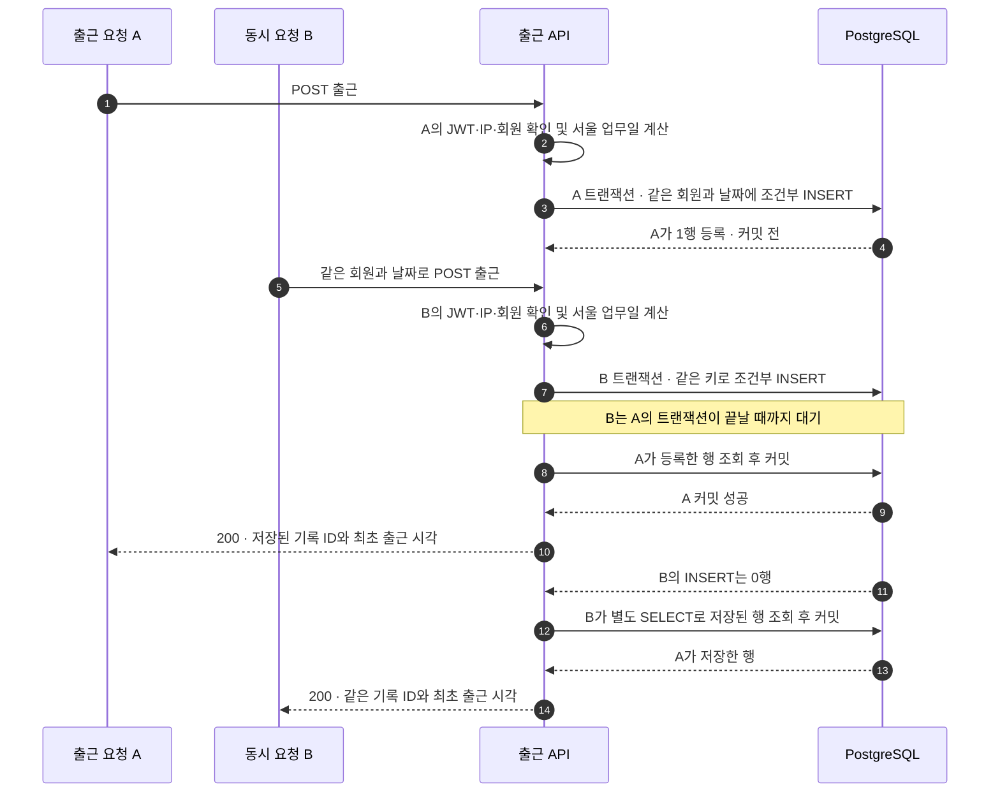

# #222 출근 API 중복 요청 멱등 처리 계획

2026-11-17 기준 로컬 구현과 HTTP 경합 검증을 마쳤다. 수정 전후 관측은 [검증 기록](../reports/evidence/222-check-in-idempotency/verification.md)에 있다.

## 1. 범위와 브랜치

[이슈 #222](https://github.com/Yanus306/yanus-groupware-BE/issues/222)의 대상은 `POST /api/v1/attendances/check-in`이다. 유효한 요청을 같은 회원과 서울 업무일 기준으로 몇 번 보내도 출근 기록은 한 건이다. 저장된 기록의 ID와 최초 출근 시각을 기존 응답 형식으로 돌려준다. 퇴근한 뒤 다시 요청하면 그 기록의 현재 상태를 돌려준다. 다음 업무일에는 새 출근을 기록한다.

| 근거 | 확인한 내용 | 구분 |
| --- | --- | --- |
| [이슈 #222](https://github.com/Yanus306/yanus-groupware-BE/issues/222) | 인증·IP 검사, 동일 업무일 재요청 `200`, 최초 기록 보존, 퇴근 후 현재 상태 반환 | 이슈에 명시된 계약 |
| 로컬 `feat/#203` (`d577d70`), 원격 `dev` (`7759f26`), 원격 `main` (`d894b9a`) | 주요 출근 Controller·Service·Repository와 V5는 동일하다. 조회 후 저장하며 순차 중복에는 `400 ALREADY_CHECKED_IN`을 반환한다. | 소스 관찰 |
| [수정 전 HTTP 재현](../reports/evidence/222-check-in-idempotency/reproduction.md) | 재시도 `400`, 두 요청의 INSERT가 겹치면 세 번 모두 `200`·`500`, DB 고유 제약 위반 `23505`와 최종 행 한 건을 확인했다. | 원격 `dev` 소스와 격리 PostgreSQL의 실행 관측 |
| [저장소 PR 목록](https://github.com/Yanus306/yanus-groupware-BE/pulls) | 확인 시점에 열린 PR이 없었다. 구현은 원격 `dev`를 기준으로 시작하는 것을 제안한다. | GitHub 조회와 구현 제안 |
| [저장소 지침](../../AGENTS.md), [프로젝트 프로필](../../.persona/project-profile.jsonc) | Java·Spring·Gradle, 도메인별 패키지, Flyway와 JDBC Template을 사용 기준으로 삼는다. 출근 조회는 현재 JPA에 구현돼 있다. | 프로젝트 기준과 소스 관찰 |

## 2. 구현할 흐름

JWT로 요청자를 확인하고, 서비스에서 기존 IP 검사와 회원 확인을 거친다. 출근 시각을 서울 시간으로 한 번 얻고 그 시각에서 업무 날짜를 구한다. DB에 한 건을 등록해 보고, 같은 회원·날짜의 기록이 이미 있으면 그 행을 읽는다. 두 경로 모두 저장된 행을 `AttendanceResponse`로 변환한다.



그림은 A가 커밋한 경우다. A가 롤백하면 대기 중인 B가 등록하고, 성공 응답은 B가 저장한 기록을 반환한다. 순차 재요청은 이미 커밋된 행을 바로 읽는다. 퇴근 뒤 재요청하면 같은 ID와 출근 시각에 `LEFT`와 저장된 퇴근 시각이 담긴다.

인증에 실패하거나 유효하지 않은 IP로 들어오면 기존 정책에 따라 `403`을 반환한다. IP가 허용되고 토큰은 유효하지만 회원이 없으면 `404 MEMBER_NOT_FOUND`를 반환한다. 각 거절 경로는 출근 저장 전에 끝난다.

## 3. 나올 코드와 메서드 초안

| 현재 코드 | 맡은 일 |
| --- | --- |
| [SecurityConfig](../../src/main/java/com/yanus/attendance/global/config/SecurityConfig.java), [AttendanceController](../../src/main/java/com/yanus/attendance/attendance/presentation/attendance/AttendanceController.java) | JWT 인증을 적용하고 회원 ID와 요청 IP를 서비스에 넘긴다. 서비스 결과를 기존 `ApiResponse`에 감싸 `200`으로 반환한다. |
| [AttendanceService](../../src/main/java/com/yanus/attendance/attendance/application/attendance/AttendanceService.java) | 트랜잭션 안에서 IP와 회원을 확인한 뒤 당일 중복을 조회한다. 현재 중복이면 예외를 던지고, 기록이 없으면 새 행을 저장한다. 날짜와 출근 시각 계산에서 현재 시간을 각각 읽는다. |
| [Attendance](../../src/main/java/com/yanus/attendance/attendance/domain/attendance/Attendance.java), [AttendanceResponse](../../src/main/java/com/yanus/attendance/attendance/application/dto/attendance/AttendanceResponse.java) | 출근 후보는 출근 시각과 해당 날짜, `WORKING`을 갖는다. 응답은 저장된 행의 ID·업무일·출근·퇴근 시각·상태를 표현한다. |
| [AttendanceRepository](../../src/main/java/com/yanus/attendance/attendance/domain/attendance/AttendanceRepository.java), [AttendanceJpaRepository](../../src/main/java/com/yanus/attendance/attendance/infrastructure/attendance/AttendanceJpaRepository.java) | 일반 저장과 `findByMemberIdAndWorkDate(memberId, workDate)` 조회를 제공한다. |

| 변경 제안 | 메서드와 책임 |
| --- | --- |
| `AttendanceService` | `checkIn(Long memberId, String clientIp)`를 단일 출근 진입점으로 사용한다. IP·회원 검사 후 서울 시각을 저장소 정밀도인 마이크로초에 맞춰 한 번 확정한다. `Attendance.checkIn(member, checkInTime)`으로 후보를 만들고, 저장소를 호출한 뒤 저장된 행으로 응답을 만든다. 테스트에서만 호출하는 `checkIn(Long)`은 호출부를 두 인자 메서드로 옮긴 뒤 정리한다. |
| `AttendanceRepository`와 `AttendanceJpaRepository` | `void insertIfAbsent(Attendance candidate)`를 추가한다. 어댑터의 `JdbcTemplate`이 회원 ID·업무일·출근 시각·`WORKING`을 바인딩해 조건부 INSERT를 수행한다. 응답용 조회는 기존 JPA 메서드를 사용한다. |
| 출근 시각용 `Clock` 설정 | 주입한 `Clock`을 서울 시간으로 변환해 사용한다. HTTP 통합 테스트에서는 자정 직전과 직후를 지정할 수 있게 테스트용 시계로 교체한다. |

## 4. 저장 기반과 주의할 점

| 기존 필드·제약 | 이번 설계에서 쓰는 방식 |
| --- | --- |
| `attendance_id` 기본 키 | DB가 부여한 값을 조회하여 모든 성공 응답에 사용한다. |
| `member_id` 외래 키, `work_date` 날짜, `UNIQUE (member_id, work_date)` | 회원과 업무일을 중복 판단 기준으로 삼는다. 이미 [Flyway V5](../../src/main/resources/db/migration/V5__create_attendance.sql)에 정의돼 있어 추가 마이그레이션은 필요 없다. |
| `check_in_time`, `check_out_time`, `status` | 최초 INSERT는 출근 시각과 `WORKING`을 저장한다. 중복 시 기존 값이 보존되며, 퇴근 이후에는 저장된 `LEFT`와 퇴근 시각을 응답한다. |

저장은 아래 형식으로 제안한다.

```sql
INSERT INTO attendance (member_id, work_date, check_in_time, status)
VALUES (?, ?, ?, ?)
ON CONFLICT (member_id, work_date) DO NOTHING;
```

- 공개 서비스 메서드에서 `READ_COMMITTED`를 명시한다. 같은 DataSource를 사용해 JDBC INSERT와 JPA SELECT를 한 트랜잭션으로 묶는다. INSERT 다음에 SELECT를 독립된 SQL 문으로 실행하면, 두 번째 요청은 그 시점에 커밋된 첫 요청의 행을 볼 수 있다. 첫 응답도 DB에서 읽은 시각을 사용해 저장 정밀도에서 재요청과 일치시킨다. [PostgreSQL 격리 수준](https://www.postgresql.org/docs/16/transaction-iso.html#XACT-READ-COMMITTED) · [Spring JpaTransactionManager](https://docs.spring.io/spring-framework/docs/6.2.x/javadoc-api/org/springframework/orm/jpa/JpaTransactionManager.html)
- 위 SQL은 해당 복합 키의 충돌만 정상 흐름으로 다룬다. 외래 키 위반이나 다른 DB 오류는 기존 오류 처리로 전달한다. 일반 INSERT의 고유 제약 예외를 같은 트랜잭션에서 잡고 조회하면 PostgreSQL에서 해당 트랜잭션이 이미 실패한 상태일 수 있다. [PostgreSQL INSERT](https://www.postgresql.org/docs/16/sql-insert.html#SQL-ON-CONFLICT)
- 업무일 경계는 서울 자정이다. 자정을 건넌 요청은 다음 업무일의 정상 출근으로 처리한다. 수동 초기화가 완료된 뒤 다시 누르면 새 기록을 만들 수 있다. 중복 INSERT 뒤 행을 읽기 전에 별도의 초기화 요청이 해당 행을 삭제한 경우에는 기존 `404 ATTENDANCE_NOT_FOUND` 반환을 제안한다.
- 설계 확인용으로 격리 PostgreSQL 16.15에 저장소의 V1·V2·V5를 적용하고 두 SQL 세션의 실제 대기를 확인했다. 앞선 세션이 커밋하면 뒤 요청은 `INSERT 0 0`과 최초 시각 `09:00:00`을 받았다. 앞선 세션이 롤백하면 뒤 요청은 `INSERT 0 1`과 자신의 시각 `09:00:01`을 받았다. 두 경우의 최종 행 수는 각각 1건이었다. Spring과 HTTP를 통한 검증은 구현 단계에서 한다.

## 5. TDD와 검증 순서

| 테스트 위치·방식 | 검증할 동작 | 기대 결과 |
| --- | --- | --- |
| `AttendanceServiceTest` · 기존 Fake 기반 | 최초 출근, 순차 재시도, 퇴근 후 재시도 | `WORKING`으로 시작한다. 재요청은 같은 ID·출근 시각이며, 퇴근 뒤에는 `LEFT`와 퇴근 시각을 반환한다. |
| `AttendanceServiceTest` · 기존 Fake 기반 | 허용되지 않은 IP, 존재하지 않는 회원 | `INVALID_ATTENDANCE_IP` 또는 `MEMBER_NOT_FOUND`로 거절하고 기록을 쓰지 않는다. |
| `AttendanceCheckInHttpIntegrationTest` · 신규 Spring Boot 임의 포트, JWT, PostgreSQL | 첫 응답을 사용하지 않고 멤버가 재요청, 두 요청을 동시에 전송 | 유효 요청은 모두 `200`이다. ID·최초 시각이 동일하고, 요청 종료 뒤 별도 DB 조회로 최종 행 1건을 확인한다. |
| 같은 HTTP 통합 테스트 | 토큰 누락·유효하지 않은 토큰, 이미 출근한 회원의 허용되지 않은 IP | 기존 `403`을 반환한다. 인증과 IP 검증은 기존 행을 반환하는 경로에서도 적용된다. |
| 같은 HTTP 통합 테스트 · 테스트용 Clock | 두 회원이 같은 날 출근, 한 회원이 서울 자정 전후 출근 | 키마다 1행이 생긴다. 자정 전후 업무일과 DB 출근 시각의 날짜가 일치한다. |
| 같은 HTTP 통합 테스트 · 독립 트랜잭션과 관측 연결 | A가 행을 등록한 뒤 커밋을 보류하는 동안 B가 같은 키로 등록을 시도 | 실제 DB 락 대기를 확인한다. A 커밋 시 B는 A의 기록을 읽고, A 롤백 시 B가 등록한다. 두 시나리오 모두 최종 행은 1건이다. |

기본 테스트 설정은 Hibernate `create-drop`과 Flyway 비활성화다. 새 통합 테스트에서는 **Testcontainers + Flyway 활성화 + Hibernate `validate`**로 V5의 실제 고유 제약을 사용한다. HTTP 요청을 동시에 출발시키는 테스트는 API 계약을 확인하고, 두 트랜잭션을 직접 제어하는 테스트는 DB 쓰기가 겹쳤다는 것을 확인한다. 대기에는 상한을 두고, `pg_blocking_pids`로 B가 실제로 기다리는 것을 확인한 뒤 A를 종료한다. [테스트 기본 설정](../../src/test/resources/application.properties)

1. **재요청·동시 등록 [Test → Feat]** 실제 재현 기록을 바탕으로 두 요청 모두 `200`이어야 하는 HTTP 테스트를 추가하고, 기존 코드의 `400`·`500`에서 각각 실패하는 것을 확인한다. 기존 서비스 테스트의 중복 예외 기대도 교체한다. 조건부 INSERT와 저장된 행 조회를 연결해 두 경로를 통과시킨다.
2. **커밋·롤백 검증 [Test]** 제안 SQL에서 확인한 선행 커밋과 롤백을 실제 애플리케이션 어댑터를 통해 검증한다. JDBC와 JPA 조회가 같은 트랜잭션을 사용해 기대한 행을 읽는지 확인한다.
3. **업무일 경계와 실패 응답 [Test → Feat]** 자정 전후, 퇴근 후 재요청, 다른 회원, 인증·IP 거절을 확인한다. 자정 테스트에 필요한 시각 주입과 정밀도 보정을 적용하고 기존 검증 순서를 유지한다.

검증에 사용한 테스트 명령은 아래와 같다. [Gradle 설정](../../build.gradle) · [CI](../../.github/workflows/ci.yml)

```bash
./gradlew test --tests '*AttendanceServiceTest' --tests '*AttendanceCheckInHttpIntegrationTest'
./gradlew test
```

## 6. 완료 기준과 다음 작업

같은 회원과 업무일의 동시 요청 및 응답 유실 후 재요청에서 두 응답이 같은 ID와 최초 출근 시각을 반환하고, 커밋된 DB 행이 한 건이면 핵심 계약을 충족한다. 퇴근 뒤 현재 상태, 서울 자정 경계, 인증·IP 거절을 위 통합 테스트에서 확인한다. 프론트 연결 확인 시 연속 클릭과 재시도에서 같은 성공 응답을 받았을 때 UI가 출근 완료 상태를 표시하는지 점검한다.

다음 후보는 [#223 근태 예외 목록 조회 SQL 최적화](https://github.com/Yanus306/yanus-groupware-BE/issues/223)다. 별도 작업으로 검증할 수 있다.
