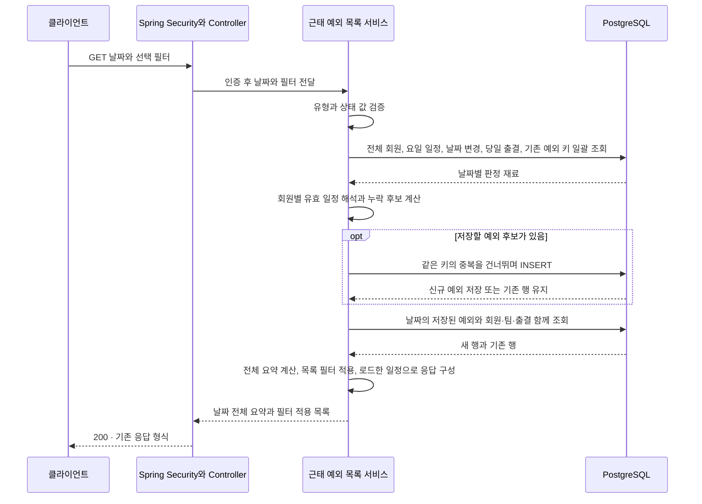

# #223 근태 예외 목록 조회 SQL 최적화 계획

2026-11-17에 `feat/#223`에서 구현했다. 수정 전후 SQL과 HTTP 지연 시간, 회귀 검증 결과는 [검증 기록](../reports/evidence/223-attendance-exception-query/verification.md)에 있다.

## 1. 범위와 브랜치

[이슈 #223](https://github.com/Yanus306/yanus-groupware-BE/issues/223)의 대상은 `GET /api/v1/attendance-exceptions?date=…`이다. 첫 조회부터 그 날짜의 예외를 계산·저장해 목록에 표시하고, 팀·유형·상태 필터와 전체 요약 계약을 유지한다. 예외 생성 단계와 응답 변환 단계의 회원별 반복 SQL을 날짜 단위 일괄 조회로 바꾼다.

| 근거 | 확인한 내용 | 구분 |
| --- | --- | --- |
| 이슈 #223 | 첫 조회에서 누락 예외 표시, 필터·전체 요약 유지, 반복·동시 조회에서 중복 생성 방지 | 계약 |
| 로컬 `feat/#203`, 원격 `dev`의 `210b463` | 구현 기준은 #222가 반영된 원격 `dev`다. 저장소의 이슈별 브랜치 관례에 따라 `feat/#223`에서 개발한다. 확인 시 열린 PR이 없었다. | 소스·GitHub 관찰과 브랜치 제안 |
| [현재 `dev` 재현](../reports/evidence/223-attendance-exception-query/reproduction.md) | PostgreSQL 16.15/Flyway V27에서 10명은 첫 73회·재조회 63회, 100명은 첫 703회·재조회 603회였다. 두 요청의 INSERT가 겹친 첫 조회에서 `200`과 `500`이 관찰됐다. | 실행 관측 |
| [공유 생성 경로](https://github.com/Yanus306/yanus-groupware-BE/blob/210b46324bef885350db6c8e64ee38ab3c1c581b/src/main/java/com/yanus/attendance/attendance/application/exception/AttendanceExceptionService.java#L127) | 목록 조회와 자동 퇴근이 `generateMissingExceptions`를 함께 쓴다. 생성 로직은 한 곳에 두고 자동 퇴근이 기존 대상만 처리하는지 회귀 테스트한다. | 소스 관찰과 설계 제안 |

앞서 작성한 리포트의 Hibernate statement 수는 이번에도 재현됐다. 100명 첫 조회는 DB 기준 SELECT 603회·INSERT 100회였고, 재조회는 SELECT 603회였다. 두 수치를 비교할 때 JDBC를 직접 사용하는 개선 쓰기도 집계하도록 PostgreSQL 호출 수를 함께 본다.

## 2. 구현할 흐름

현재는 회원별로 일정·출결·기존 예외를 조회해 후보를 저장하고, 응답의 일정 필드를 만들면서 같은 일정을 다시 조회한다. 개선안에서는 요청 날짜에 필요한 정보를 먼저 묶어서 읽는다. 같은 일정 해석 결과로 예외를 판정하고 목록을 만든다.



예를 들어 A팀 2건과 B팀 3건이 있는 날짜를 A팀으로 조회하면 `totalCount=5`, `filteredCount=2`, 목록 2건이다. `openCount`와 유형별 카운트도 날짜 전체 기준이다. 따라서 팀 필터는 목록에 적용하고, 첫 조회에서 양쪽 팀 예외가 만들어지는 기존 계약을 유지한다. 잘못된 유형·상태는 후보를 만들기 전에 기존 `400 BAD_REQUEST`로 처리한다.

## 3. 나올 코드와 메서드 초안

| 현재 위치 | 역할 |
| --- | --- |
| `AttendanceExceptionController.getExceptions`와 `AttendanceExceptionService.getList` | 날짜와 선택 필터를 받고 문자열 enum을 검증한다. 생성, 전체 데이터 조회, 목록 필터, 요약, 응답 변환을 처리한다. |
| `AttendanceExceptionService.generateMissingExceptions` / `findSchedule` | 전체 회원을 순회하고 날짜별 변경 일정과 주간 근무를 회원마다 조회한다. 날짜별 `WORKING`이 우선하며 `DAY_OFF`는 주간 근무를 가린다. |
| `AttendanceExceptionJudge.judgeByScheduledStart` / `AttendanceException.open` | 예외 유형을 판단하고 해당 유형의 `OPEN` 상태 객체를 만든다. |
| `AttendanceExceptionRepository` / `AttendanceExceptionJpaRepository` | 날짜 목록, 회원·날짜·유형 단건 검색과 JPA 저장을 제공한다. 응답 DTO는 회원·팀 이름과 연결된 출결을 읽는다. |

| 변경 제안 | 메서드·책임 |
| --- | --- |
| `AttendanceExceptionService.generateMissingExceptions(date)` | 전체 회원과 필요한 일정을 한 번씩 읽고, 유효 근무일정을 회원 ID로 인덱싱한다. 출결과 기존 예외 키도 메모리에서 조합한다. 서울 시각은 한 번 읽고 기존 판정기로 빠진 키만 신규 후보를 만든다. 일정이 없으면 판정기가 퇴근 누락을 계산하지 않으므로 이 경로에서는 기본 자동 퇴근 설정 조회를 생략한다. 목록 응답에서 사용할 유효 일정 맵을 반환한다. |
| 일정·출결 저장소 | 주간 일정에 `findAllByDayOfWeek(DayOfWeek)`를 추가한다. 날짜별 일정은 기존 `findAllByDateBetween(date, date)`, 출결은 기존 `findAllByWorkDate(date)`를 사용한다. 현재 회원 조회 범위는 `MemberRepository.findAll()`로 재현했다. |
| `AttendanceExceptionRepository`와 JPA 조회 | `findKeysByWorkDate(date)`는 `(memberId, type)`만 읽는다. `findAllByWorkDateWithDetails(date)`는 예외·회원·팀을 함께 읽고 출결은 LEFT JOIN FETCH로 붙인다. 출근 기록이 없는 누락 예외도 포함한다. |
| 새 저장 포트 `AttendanceExceptionInsertRepository`와 JDBC 구현 | `insertMissing(List<AttendanceException> candidates)`는 도메인에서 만든 후보의 키와 초기 필드만 배치 INSERT한다. 기존 고유 키의 충돌은 `DO NOTHING`으로 처리한다. 최종 응답은 저장 결과를 다시 읽으므로 두 동시 조회 모두 같은 기존 행을 볼 수 있다. |
| `AttendanceExceptionService.getList` / 응답 변환 | 저장 이후 조회한 예외로 전체 요약과 필터 목록을 만들고 회원별 일정 맵을 재사용한다. 단건 승인·반려·해결·메모 응답에 쓰이는 일정 조회 경로도 기존대로 동작하는지 확인한다. |

공유 생성 메서드를 쓰는 `getExceptions`와 자동 퇴근도 같은 충돌 방지 저장 경로를 사용한다. 자동 퇴근의 대상 선택과 상태 변경은 현재 계약으로 회귀 검증한다. 예외 판정의 주차·누락 기준과 멤버 범위는 현재 동작 그대로 비교한다. 성능 변경과 판정 정책 변경을 동시에 하면 응답 차이가 어디서 생겼는지 검증하기 어렵다.

## 4. 저장 기반과 주의할 점

| 현재 저장 구조 | 계획 |
| --- | --- |
| [V20 근태 예외 고유 제약](https://github.com/Yanus306/yanus-groupware-BE/blob/210b46324bef885350db6c8e64ee38ab3c1c581b/src/main/resources/db/migration/V20__create_attendance_exception.sql#L15) | `UNIQUE(member_id, work_date, type)`와 날짜 인덱스를 사용한다. 추가 Flyway 변경 없이 기존 키에 `ON CONFLICT DO NOTHING`을 적용할 수 있다. |
| 기존 승인·반려·해결과 메모 | 기존 키를 만나면 UPDATE 없이 유지한다. 날짜 단위 신규 후보 목록은 `(memberId, type)` 순서로 맞춰 동시에 여러 키를 저장할 때 잠금 순서를 일치시킨다. |
| 출근 누락 예외의 `attendance_id` | NULL을 정상값으로 저장한다. 목록 조회에서도 출결이 붙지 않은 행을 반환한다. 초기 상태·생성 시각은 `AttendanceException.open`이 만든 값을 유지하고 JDBC 타임스탬프 바인딩은 현재 Hibernate 설정에 맞춘다. |

기존 키 조회는 불필요한 쓰기를 피하는 용도다. 두 요청이 같이 키를 읽으면 모두 대상이 없다고 볼 수 있으므로, 최종 중복 판정은 PostgreSQL에 맡긴다. 조회·삽입·삽입 후 읽기는 동일 DataSource와 트랜잭션에서 실행한다. `READ COMMITTED`에서 INSERT의 충돌 처리가 끝난 다음 별도 SELECT를 실행하면 먼저 커밋된 행을 결과에 담을 수 있다. 관계 제약 위반 등 다른 저장 실패는 트랜잭션을 롤백한다. [PostgreSQL 격리 수준](https://www.postgresql.org/docs/16/transaction-iso.html#XACT-READ-COMMITTED)

기준 fixture에서 회원·주간 일정·날짜별 일정·출결·기존 키·최종 목록의 6개 SELECT를 확인했다. JDBC 배치로 묶어 보내도 PostgreSQL이 센 INSERT 실행 횟수와 네트워크 왕복 수는 서로 다를 수 있다. 날짜·요일 조건에 대한 새 인덱스가 필요한지는 대표 데이터의 실행 계획으로 판단한다.

## 5. TDD와 검증 순서

| 테스트 위치·방식 | 핵심 검증 | 기대 결과 |
| --- | --- | --- |
| 기존 `AttendanceExceptionServiceTest` · Fake | 두 팀에 다른 상태·유형의 기존 예외, `WORKING` 변경·`DAY_OFF`·익일 근무, 유효하지 않은 유형·상태 | 첫 목록과 기존 상태·메모·일정 시간이 기대와 같다. 세 필터는 목록과 `filteredCount`에만 적용된다. 잘못된 필터에서는 어떤 예외도 생성하지 않는다. |
| 신규 `AttendanceExceptionQueryIntegrationTest` · 실제 PostgreSQL/Flyway | 10명·100명에서 같은 날짜의 최초·재조회, 설정이 필요한 별도 fixture | 기준 fixture에서 SELECT가 양쪽 크기 모두 고정된 범위에 든다. 목표 상한은 7회다. 첫 조회는 필요한 행만 쓰고 재조회는 쓰기 0회다. |
| 같은 통합 테스트 · 실제 HTTP 두 연결 | 두 INSERT가 실제로 대기하는 첫 조회, 승인·반려 행이 섞인 날짜 | 두 HTTP 응답 모두 `200`이고 기존 상태 및 메모가 보존된다. 날짜·회원·유형별 행이 한 건이다. |
| 기존 자동 퇴근 테스트 및 실제 DB 경계 테스트 | 자동 퇴근이 먼저 생성해야 하는 대상, 커밋 실패·롤백 | 현재 대상 선택과 퇴근 시각 규칙을 유지한다. 저장이 실패하면 부분 예외가 남지 않는다. |

1. **결과 기준부터 고정**한다. 두 팀의 응답과 기존 상태, 날짜별 일정 우선순위를 작성한다. PostgreSQL 테스트 설정은 Testcontainers 16.15·Flyway 활성화·Hibernate `validate`로 V20을 사용한다.
2. **쿼리 상한으로 실패를 만든다.** 10명과 100명의 SELECT를 PostgreSQL에서 센다. 생성·응답 쪽 일괄 조회와 일정을 재사용하는 변환을 적용해 두 크기에서 고정되는지 확인한다.
3. **동시 요청의 `500`을 실패 테스트로 고정**한다. 두 INSERT 대기를 독립 연결에서 확인한 뒤 잠금을 해제하고, 예상한 2개의 `200`과 DB 상태를 검증한다. 고유 키 충돌을 건너뛰는 저장을 연결한다.
4. **성능은 HTTP에서 별도로 비교**한다. 기준 커밋과 개선 커밋을 같은 JDK·PostgreSQL·fixture·요청 부하에서 측정한다. 최초 조회는 예외가 없는 날짜의 첫 요청만, 재조회는 이미 생성된 날짜만 측정한다. 워밍업은 측정에서 제외하고, 각 실행의 요청 수·동시 수·p95·오류율을 함께 남긴다. SQL에는 Hibernate와 PostgreSQL 결과를 나란히 기록하고 SELECT·INSERT·UPDATE·DELETE를 구분한다.

기존 응답과 개선 응답의 예외는 `(회원 ID, 날짜, 유형)`으로 대조한다. 새 DB에서 생성한 ID와 생성 시각은 달라질 수 있으므로, 기존 행의 ID·승인·반려·메모는 같은 DB에서 검증한다. 화면 성능 비교용으로 생성형 fixture를 쓰며 운영 호스트 응답으로 해석할 수 없다.

```bash
./gradlew test --tests '*AttendanceExceptionServiceTest' --tests '*AttendanceExceptionJudgeTest' --tests '*AttendanceExceptionQueryIntegrationTest'
./gradlew test
```

위 통합 테스트 클래스 이름은 구현 제안이다. 기존 테스트는 Gradle/JUnit과 실제 PostgreSQL 테스트 의존성이 구성돼 있다.

## 6. 완료 기준과 다음 작업

100명 첫 조회 703회·재조회 603회와 동일한 fixture에서 개선 후 DB 쿼리 수를 표로 남긴다. 10→100명에서 SELECT가 회원별로 늘지 않고, 첫 조회의 예외 생성·필터·전체 요약이 맞아야 한다. 같은 날짜를 동시 조회해도 2개의 `200`과 키당 한 행이 보장되고 기존 승인·반려 상태가 유지돼야 한다. HTTP p95와 오류율은 별도 전후 비교로 기록한다.

기준값과 실행 방법은 [수정 전 재현 기록](../reports/evidence/223-attendance-exception-query/reproduction.md)에 있다. 구현은 `feat/#223`에서 시작해 현재 계약을 고정하는 테스트부터 진행한다.
