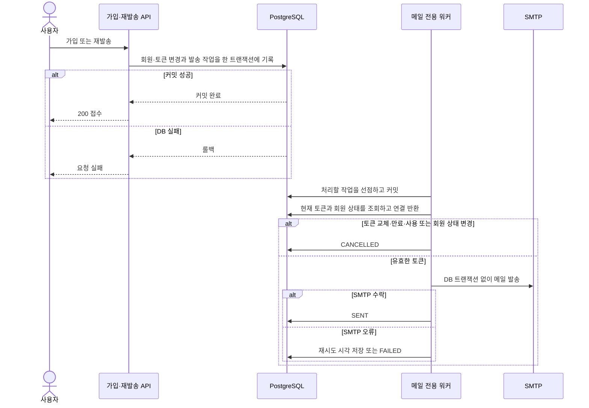

# 회원가입 인증 메일 비동기 발송 및 복구 계획

## 1. 범위와 브랜치

2026-11-24 KST 기준 #232 구현은 `dev@7610b37`을 기준으로 분리한 `feat/#232` 작업 공간에 있다. 아래는 구현의 기준이 된 설계다. [코드 읽는 순서](../reports/evidence/232-email-verification/code-walkthrough.md) · [실제 검증 결과](../reports/evidence/232-email-verification/README.md)

| 확인 대상 | 확인한 내용 |
| --- | --- |
| 기본 동작 | 가입 시 `PENDING`, 이메일 인증 후 `ACTIVE`라는 기존 기능 계약을 유지한다. 문서의 만료시간 제안과 현재 구현이 달라 토큰 유효기간은 코드에 있는 30분을 따른다. [기존 이슈 #139](https://github.com/Yanus306/yanus-groupware-BE/issues/139) |
| 백엔드 | 가입과 재발송이 같은 발송 메서드를 호출한다. SMTP는 회원·토큰을 다루는 트랜잭션 안에서 동기 실행된다. [AuthService](https://github.com/Yanus306/yanus-groupware-BE/blob/7610b37b91e84d42f5b89f2793289e73c0467ef7/src/main/java/com/yanus/attendance/auth/application/AuthService.java#L37) · [EmailVerificationService](https://github.com/Yanus306/yanus-groupware-BE/blob/7610b37b91e84d42f5b89f2793289e73c0467ef7/src/main/java/com/yanus/attendance/auth/application/EmailVerificationService.java#L24) |
| 프론트 계약 | 가입과 재발송 호출은 200 뒤 화면을 전환하거나 안내를 표시한다. 비동기 전환 시 URL, 입력, 200 및 응답 본문은 유지하고, 메일이 발송됐다고 단정하는 안내는 접수 문구로 바꾼다. [기준 인증 화면](https://github.com/Yanus306/yanus-groupware/blob/e2f395e66cbde13f147512fc4103f9aa52dd64b7/src/pages/verify-email/index.tsx#L74-L79) |
| 스키마와 배포 | 원격 `dev`의 V28은 캘린더 캐시 리비전이다. 로컬 감사 브랜치에도 별도의 V28이 있다. 확인 시점에 `dev` 대상 열린 PR 조회 결과는 없었으나 구현 직전에 번호 충돌을 다시 확인한다. 운영에 설치된 Flyway 이력은 이번에 조회하지 않았다. |

대상은 `POST /api/v1/auth/register`, `POST /api/v1/auth/verify-email/resend`와 인증 상태 정합성을 검증할 `POST /api/v1/auth/verify-email`이다. 본 작업의 첫 구현 범위는 기존 인증 메일을 다루는 PostgreSQL 작업 테이블, 발송 워커, 동일 조건 전후 검증이다.

## 2. 구현할 흐름

**현재 흐름**

```text
가입 POST → AuthService.register() → PENDING 회원 저장
재발송 POST → EmailVerificationService.resend() → 회원 조회
                     ↓ 두 요청의 공통 경로
기존 토큰 삭제 → 신규 30분 토큰 저장 → SMTP 동기 발송 → DB 커밋 → HTTP 200
```

SMTP가 느리면 HTTP 응답과 트랜잭션 종료가 함께 늦어진다. 발송 예외가 밖으로 전달되면 가입 시 회원·토큰이, 재발송 시 토큰 교체가 롤백된다. SMTP가 먼저 수락한 뒤 DB 커밋에 실패하는 경우에는 이미 보낸 메일의 토큰이 저장되지 않을 수 있다. 실제 운영에서 이 조건이 얼마나 자주 발생하는지는 로그와 격리 재현으로 확인한다.

**개선 흐름**



사용자가 가입하면 계정은 계속 `PENDING`이다. 200은 회원·토큰과 발송 요청이 함께 저장됐다는 뜻이다. 인증 코드가 메일로 도착한 후 실제 인증이 성공해야 로그인할 수 있다. 재발송은 기존처럼 새 토큰을 만들고 이전 토큰을 무효화한다. 이미 인증됐거나 비활성인 회원의 재발송은 기존 200 응답 형태로 종료하되 토큰이나 작업을 만들지 않는 동작을 제안한다. 존재하지 않는 회원의 오류와 이미 사용되거나 만료된 토큰의 오류는 기존 계약을 따른다.

`@Async`나 커밋 후 이벤트만으로도 HTTP 대기는 분리할 수 있다. 재시작 후에도 미처리 작업이 필요하므로, 기존 PostgreSQL에 작업을 영속화하는 Transactional Outbox를 선택한다. 시작 규모는 서버당 전용 워커 한 개로 두고, 대기 작업과 실제 유입량을 확인해 조정한다. [Spring 트랜잭션 이벤트](https://docs.spring.io/spring-framework/reference/data-access/transaction/event.html) · [Transactional Outbox](https://docs.aws.amazon.com/prescriptive-guidance/latest/cloud-design-patterns/transactional-outbox.html)

## 3. 나올 코드와 메서드 초안

| 위치 | 현재 책임과 변경안 | 메서드 후보 |
| --- | --- | --- |
| `auth/presentation/AuthController` | 가입, 토큰 검증, 재발송으로 위임한다. 응답 스키마와 HTTP 경로를 재사용한다. | `register()`, `verifyEmail()`, `resendVerification()` |
| `auth/application/AuthService` | 가입 검증·비밀번호 해시·`PENDING` 회원 저장 뒤 인증 작업을 등록한다. | `register(RegisterCommand)`에서 `enqueueVerification(saved.getId())` |
| `auth/application/EmailVerificationService` | 같은 트랜잭션에서 신규 토큰과 발송 작업을 저장한다. `resend()`와 `verify()`는 같은 회원 행을 잠근 뒤 유효한 상태와 토큰을 다시 확인한다. 토큰 검증은 회원 ID만 먼저 조회해, 잠금 전에 읽은 토큰 엔티티를 재사용하는 문제를 피한다. | `enqueueVerification(memberId)`, `resend(email)`, `verify(token)` |
| `auth/infrastructure/EmailVerificationJobStore` (신규) | 기존 JPA 트랜잭션에 참여하는 JDBC로 작업 INSERT. 워커에서 쓰는 선점·상태 변경은 각각 짧은 트랜잭션이다. | `enqueue(tokenId)`, `claimNext()`, `loadDelivery(claim)`, `markSent(claim)`, `recordFailure(claim, reason)`, `cancel(claim)` |
| `auth/application/EmailVerificationWorker` (신규) | 전용 스케줄러에서 작업을 하나씩 가져오고, 발송 가능한지 읽은 다음 SMTP를 호출한다. 워커 전체에 트랜잭션을 두지 않는다. | `poll()` |
| `auth/application/EmailService` | 메일 메시지 생성과 JavaMailSender 연동을 재사용한다. 메일 문구는 발급 후 30분이라는 기준을 전달한다. | `sendVerificationEmail(email, token)` |

아래는 중요한 경계만 보인 Java 초안이다. 각 메서드의 유효성 검사와 예외 매핑은 표와 검증 절에서 다룬다.

```java
// 현재 EmailVerificationService. 이 메서드는 트랜잭션 안에서 호출된다.
public void sendVerification(Long memberId, String email) {
    tokenRepository.deleteByMemberId(memberId);
    String token = UUID.randomUUID().toString();
    tokenRepository.save(EmailVerificationToken.create(token, memberId, LocalDateTime.now().plusMinutes(30)));
    emailService.sendVerificationEmail(email, token);
}

// 제안. 가입 또는 재발송의 기존 트랜잭션에서 두 행을 함께 저장한다.
public void enqueueVerification(Long memberId) {
    tokenRepository.deleteByMemberId(memberId);
    var token = EmailVerificationToken.create(UUID.randomUUID().toString(), memberId,
            LocalDateTime.now(clock).plusMinutes(30));
    var saved = tokenRepository.save(token);
    jobs.enqueue(saved.getId());
}

// 제안. poll() 자체에는 트랜잭션을 붙이지 않는다.
public void poll() {
    var claim = jobs.claimNext();
    if (claim.isEmpty()) {
        return;
    }

    var job = claim.get();
    var delivery = jobs.loadDelivery(job);
    if (delivery.isEmpty()) {
        jobs.cancel(job);
        return;
    }

    try {
        emailService.sendVerificationEmail(delivery.get().email(), delivery.get().token());
    } catch (MailException failure) {
        jobs.recordFailure(job, classify(failure));
        return;
    }
    jobs.markSent(job);
}
```

`EmailVerificationJobStore.enqueue()`가 다른 트랜잭션을 생성하지 않도록 강제하고, 실제 JPA 저장과 JDBC INSERT가 같은 커밋을 쓰는지 PostgreSQL로 증명한다. `poll()`이 사용하는 별도 메일 스케줄러는 기존 자동 퇴근 스케줄러를 공유하지 않는다. SMTP connect/read/write timeout을 설정하고, `markSent()`의 DB 실패와 SMTP 실패를 구분한다. [Spring Boot 메일 설정](https://docs.spring.io/spring-boot/3.5/reference/io/email.html)

## 4. 저장 기반과 주의할 점

Flyway로 `email_verification_job`을 추가한다. 작업에는 토큰 ID만 참조하고 토큰 문자열과 수신 주소는 발송 직전 기존 테이블에서 읽는다.

| 필드 또는 상태 | 역할 |
| --- | --- |
| `id`, `token_id` | 작업 식별자. 토큰당 작업 1건을 `UNIQUE`로 보장한다. 토큰을 교체하면 `ON DELETE SET NULL`로 이력을 남기고 선점된 작업도 발송 직전 유효성 검사에서 제외한다. |
| `status` | `PENDING`, `PROCESSING`, `SENT`, `FAILED`, `CANCELLED`. 대기 상태와 만료된 선점을 효율적으로 조회하도록 인덱스를 둔다. |
| `attempt_count`, `next_attempt_at` | 재시도 횟수와 다음 실행 시각. 일시적 오류에 한해 지수형 간격으로 재시도하고, 남은 토큰 유효기간과 최대 횟수로 제한한다. |
| `lease_id`, `lease_until` | 어떤 실행이 일정 시간 동안 작업을 맡았는지 기록한다. 서버가 종료되면 만료 후 다른 실행이 이어받는다. 완료·실패 반영은 현재 lease ID가 일치할 때만 허용한다. |
| `created_at`, `updated_at`, `last_error_code` | 요청 시점, 상태 변경, 안전한 실패 분류를 남긴다. 이메일 주소·토큰·SMTP 원문은 작업이나 관측 지표에 복제하지 않는다. |

- **동시 선점.** 한 SQL에서 기한이 된 작업 행 하나를 `FOR UPDATE SKIP LOCKED`로 고르고 `PROCESSING`으로 바꾼다. 선점 트랜잭션은 SMTP 전에 커밋한다. 두 워커가 같은 선점에 성공할 수 없는지, 만료 뒤의 옛 실행 결과가 새 작업 상태를 덮지 않는지 실제 DB로 확인한다. [PostgreSQL SELECT](https://www.postgresql.org/docs/current/sql-select.html#SQL-FOR-UPDATE-SHARE)
- **장애 이후 종료 상태.** 선점 직후 강제 종료도 시도 횟수에 반영한다. 회수 시 토큰이 무효면 `CANCELLED`, 재시도 횟수가 소진됐으면 `FAILED`로 끝낸다. 재시도는 원래 토큰을 사용하고, 새 토큰은 사용자의 재발송 요청에서만 만든다.
- **재발송과 발송 경합.** 회원별 재발송과 인증을 직렬화해 유효한 토큰 하나를 유지한다. 워커가 토큰을 확인한 직후 재발송하면 먼저 시작한 SMTP가 이전 메일을 전달할 수 있다. 그 코드의 인증은 DB에서 실패해야 한다. DB 락을 SMTP가 끝날 때까지 잡지 않는 설계의 경계다.
- **SMTP 수락과 DB 완료 사이.** SMTP 수락 직후 프로세스가 종료되거나 응답을 잃으면 재시도에서 같은 메일이 갈 수 있다. 작업 선점 중복과 외부 메일 중복을 따로 검증한다. `SENT`는 SMTP 서버가 수락했다는 뜻이며 메일함 도착은 별도로 검증한다. [SMTP 표준 RFC 5321](https://www.rfc-editor.org/rfc/rfc5321.html#section-4.5.4.1)
- **공개 API와 배포.** 재발송은 공개 API다. 이메일당 짧은 간격의 재접수 제한이 필요한지 운영 요청을 보고 정하고, 워커의 동시성과 재시도는 처음부터 제한한다. 적용된 Flyway 번호와 충돌을 구현 직전 확인한다. 현재 `main` CD의 사전 검사는 스키마 변경을 차단하므로 격리 환경에서 기존 DB에 적용하고 롤백할 수 있는지 확인한 뒤 운영 스키마 절차를 별도로 정한다. [배포 사전 검사](https://github.com/Yanus306/yanus-groupware-BE/blob/7610b37b91e84d42f5b89f2793289e73c0467ef7/ops/deploy/preflight.mjs#L5)

## 5. TDD와 검증 순서

| 순서·테스트 위치 | 먼저 확인할 실패 또는 기존 동작 | 다음 구현과 통과 기준 |
| --- | --- | --- |
| 0. 변경 전 기준선 · 실제 HTTP, PostgreSQL, 제어 가능한 SMTP | 정상 응답, 지연, SMTP 수락 후 DB 롤백, SMTP 서버 오류를 재현한다. 코드 예측은 실험 결과로 표기하지 않는다. | 가입·재발송 응답, 회원·토큰 DB 상태, SMTP 소요 시간, Hikari 사용·대기를 원시 결과에 남긴다. |
| 1. 가입 접수 · PostgreSQL 통합 + HTTP | 강제 롤백하거나 작업 INSERT에 실패해도 회원이나 토큰만 남아서는 안 된다. SMTP가 멈춰도 접수는 끝나야 한다. | 마이그레이션과 enqueue를 추가한다. 200이면 회원·토큰·작업이 함께 조회된다. 롤백 시 세 가지가 모두 없고 SMTP 호출도 없다. |
| 2. 재발송과 인증 · 서비스 단위 + PostgreSQL 경합 | 토큰 교체 상태와 유효한 코드가 어긋나거나, 경합으로 토큰이 여러 개 생기는지 확인한다. | 같은 회원의 두 재발송 및 인증과 재발송 경합에서 토큰·회원·작업 상태가 일치한다. 이전·만료·사용 토큰은 실패하고 정상 토큰으로만 `PENDING → ACTIVE`가 된다. 기존 미인증 계정도 재발송할 수 있다. |
| 3. 선점과 발송 · PostgreSQL + 로컬 SMTP | 두 워커로 동시에 하나의 작업을 보거나, SMTP를 기다리는 동안 DB 커넥션을 잡는지 확인한다. | 한 워커만 같은 lease를 얻고 SMTP 지연 구간의 트랜잭션은 종료돼 있다. 무효 작업은 취소되고, 유효 작업은 실제 SMTP 수락 후 SENT가 된다. |
| 4. 오류·재시작 · 실제 프로세스 강제 종료 + SMTP 제어 | 큐잉 직후, 선점 직후, 수락 직후 DB 업데이트 전에 각각 종료한다. SMTP 연결 끊김·일시 오류·영구 오류도 재현한다. | 미처리 또는 만료된 lease를 회수한다. 일시 오류는 유효기간 내 제한적으로 재시도한다. 영구 오류·만료·최대 횟수 도달은 종료 상태로 남긴다. 수락 직후 장애는 실제 수신 건수와 DB 상태를 따로 남긴다. |
| 5. 계약·배포·Gatling · HTTP·Flyway·Grafana | 같은 데이터와 요청 순서로 두 버전을 번갈아 실행하고, 인증 화면의 접수 문구도 확인한다. | 지연과 오류가 가입·재발송 및 다른 API에 얼마나 전파되는지 전후 비교한다. 배포 전 기존 스키마에 적용 후 부팅과 복구를 검증한다. |

Gatling은 인증 계정과 테스트 팀을 준비한 뒤 **가입은 매 요청 고유 이메일**, **재발송은 서로 다른 기존 PENDING 계정**, **영향 비교는 ACTIVE 계정의 `GET /api/v1/auth/me`**로 구성한다. 가입·재발송은 각각 따로 측정한 뒤 읽기 트래픽과 섞는다. 실제 유입 기준은 Grafana의 해당 경로별 피크·시간 분포를 먼저 확인해 정한다. 표본이 부족할 때는 피크를 추정하지 않고 부하 단계가 합성 조건임을 표시한다.

| 비교 조건 | 기록할 결과 |
| --- | --- |
| SMTP 정상, 응답 지연 예시 500ms·2s, 차단 후 복구 | 가입·재발송·`/me` 경로별 응답 p50/p95, 성공률, Hikari active/pending·획득 대기 |
| 동일 DB seed, 앱 자원, 요청률, 워밍업, SMTP timeout | 변경 전 동기와 변경 후 큐를 교차 반복한다. 실행 순서·커밋·실제 성공률·원시 지표를 같이 저장한다. |
| 비동기 발송 대기와 메일 장애 | 접수부터 SMTP 수락까지 p95, 대기 작업 수/최고 대기 시간, 재시도 횟수, 실패/취소 건수, 장애 해제 뒤 적체 해소 시간을 기록한다. |

신규 테스트 클래스가 추가되면 `./gradlew test --tests '*AuthServiceTest' --tests '*EmailVerification*'`로 집중 검증하고 `./gradlew test`로 전체 테스트를 확인한다. DB 경합과 Flyway 검증은 H2 기본 프로필과 별도로 실제 PostgreSQL Testcontainers에서 실행한다.

## 6. 완료 기준과 다음 작업

1. 변경 전후를 같은 SMTP 조건에 두고 API p95와 Hikari 대기, 실제 발송까지의 시간을 재현 가능한 형태로 남긴다.
2. 커밋/롤백과 워커 재시작을 실제 PostgreSQL·SMTP 테스트로 재현한다. 같은 회원의 재발송과 인증이 겹쳐도 일관된 결과를 확인한다.
3. 비동기 접수 성공을 SMTP 수락 또는 메일함 도착과 구분해 사용자 문구와 관측 지표에 반영한다.
4. 운영 증거와 격리 실험을 구분한다. 이력서 수치는 실제 유입 또는 명시한 장애 주입 조건과 함께 측정 후 확정한다.

현재 남겨 둔 계획상 결정은 PENDING이 아닌 회원의 재접수 응답과 SMTP 타임아웃·재시도 정책의 초기값이다. 운영 로그와 테스트에서 근거를 확인하고, Flyway 번호는 작업을 시작할 때 승인된 기준 브랜치에 맞춘다.
